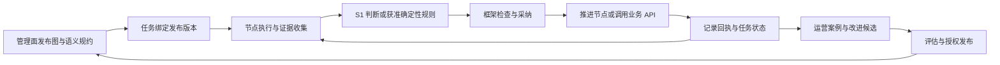

# Agent Hub Alpha

**面向企业核心业务的下一代智能体架构研究与参考实现。** 基于 openJiuwen 演进，结合 Jev 类决策模型与 Agentic Model，让智能体的判断、执行和持续改进具备明确的业务语义、控制边界与工程证据。

[GitHub](https://github.com/chaosxingxc-orion/agent-hub-alpha) · [GitCode](https://gitcode.com/xingchao_ml/agent-hub-alpha) · [架构讨论](https://github.com/chaosxingxc-orion/agent-hub-alpha/issues/1) · [GitCode 讨论](https://gitcode.com/xingchao_ml/agent-hub-alpha/issues/1) · [同步状态](https://github.com/chaosxingxc-orion/agent-hub-alpha/actions/workflows/sync-gitcode.yml)

**项目阶段：架构研讨、契约定义与参考组件验证。** 已有代码能够支持部分机制研究，完整 Java SDK、openJiuwen 集成、企业工作台和生产运行闭环仍需实现与验收。本文介绍项目定位和共同原则；具体机制读 [07 主提案](achitecture%20design/07-nga-architecture-proposal.md)，实际完成程度读 [当前验收状态](achitecture%20design/08-r1-r6-acceptance-and-open-items.md)。

## 1. 我们要解决什么问题

上一代智能体框架主要围绕 Agentic Model 的规划、执行、反思和重规划构建 Agent Loop。这让模型能够处理开放任务，但在企业核心业务中，同一业务依据被反复送入生成式模型时，可能产生不同路径、判断或执行结果。

本项目把**决策一致性、重复执行的幂等性，以及可回放、可审计的业务执行**作为核心目标。我们希望把模型能力转化为企业能够配置、验证、控制和持续改进的工作方式。

这些目标必须分别成立：

| 目标 | 我们要求的行为 |
| --- | --- |
| 决策一致性 | 在声明的等价输入、语义规约和有效性范围内保持一致；关键事实或规则改变时能作出有依据的区别 |
| 决策幂等 | 同一决策身份和依据的重复提交，解析到原有采纳记录，不反复生成新的有效决定 |
| 执行结果与业务请求幂等 | 同一节点执行实例重试复用已确认结果；业务请求保持稳定身份，重复效果控制遵循业务 API 的实际能力 |
| 回放与回溯 | 用保留的输入、版本、事件和回执解释并重现控制过程；回放隔离真实副作用，重新评估单独编号 |
| 审计与纠错 | 能查明谁在何时、依据什么作了何种判断和动作；错误通过关联修订与处置纠正，原记录保留 |
| 可用性与可靠性 | 对正常、未配置、规则未覆盖、缺证据、依赖故障及未知外部结果，都有明确状态和获准处置 |

**一致不等于正确，重复得到错误答案也不符合项目目标。** Jev、S2、检查器和业务数据均可能出错。我们通过版本化规约、证据、必要检查、生效控制和运营反馈降低风险，并明确每项保证的适用范围。

## 2. 与 NGA 的关系：三个方向、两个代码仓

NGA 的全称是 **Next Generation Agent**。整个研究计划包含三个相互连接的方向：

| 方向 | 主要工作 | 所在仓库 |
| --- | --- | --- |
| Jev 类决策模型 | 从业务目标定义学术任务，合成和治理数据，复现相关工程，设计、训练与评测模型 | [NGA · GitHub](https://github.com/chaosxingxc-orion/nga) / [GitCode](https://gitcode.com/xingchao_ml/nga) |
| S1 + S2 智能体框架 | 定义协作方式、任务与决策身份、准入、执行、恢复、回放和审计 | **本仓** |
| 企业工作台与知识工程 | 维护语义规约、智能体定义与发布，支撑开发、运行、运营和受控进化 | **本仓的后续交付方向** |

模型复现是研究起点；业务一致性与可配置能力决定后续模型改造目标。框架可以先使用明确的模型替身或能力假设验证控制机制，但替身实验不能证明真实 Jev 模型已经具备这些能力。

Jev/KEV/BEV 等模型实验及其训练、评测和执行基础设施留在 NGA。本仓不复制训练管线，也不把框架验收结论当作模型实验结果。[研究综述](https://github.com/chaosxingxc-orion/nga/blob/main/survey/README.md)和[总体研究设计](design/nga-overall-design.md)提供背景；[迁移说明](docs/migration/README.md)记录两个仓库的来源和边界。

## 3. 总体结构：一体、三态、四面

**一体是智能体进化**：将真实业务结果和运营案例转化为知识、数据、规则、模型或执行方法的改进候选，经过评估与授权发布，再进入生产。这条链路贯穿各面，不能成为运行时绕过治理的入口。

**三态是开发态、运行态、运营态**；**四面是用户面、运行面、管理面、控制面**。它们是交叉的职责维度，不等于三个部署环境或十二个独立服务。

| 面 | 开发态 | 运行态 | 运营态 |
| --- | --- | --- | --- |
| 用户面 | 描述目标、试用候选行为、提供反馈 | 提交任务、补充材料、查看结果或申请干预 | 反馈业务体验，查看获准的案例与改进结果 |
| 运行面 | 接入模型、工具和组件，执行测试 | 执行已获准节点、消费知识、等待回执、恢复任务 | 提供真实执行事实和受控回放能力 |
| 管理面 | 治理业务规约、智能体定义、权限策略与发布配置 | 维护版本适用范围、运营策略和变更审批 | 管理案例、规则保鲜、评估和改进发布 |
| 控制面 | 检查发布和能力接入条件 | 按权威状态实施准入、当前有效性、授权、预算与异常处置 | 执行获准的停用、迁移、恢复和纠错控制 |

企业规则由管理面统一治理，控制面实施生效约束。模型和单个开发团队不能自行填补规则空白或放宽权限。多面可以由同一进程中的组件实现，边界仍须清晰。

## 4. S1、S2 与框架分别负责什么

| 角色 | 职责 | 控制权边界 |
| --- | --- | --- |
| **S1 / Jev 类能力** | 消费版本化语义规约和适用证据，输出类型化判断、依据与无法判断状态 | 判断是待采纳输入，不自行发布规则、授予权限或提交业务效果 |
| **S2 / Agentic Model** | 开发态辅助规划；运行时在节点契约内调查、补证、调用获准能力、评价结果及提出改进 | 不能绕过检查、改写已生效历史，或自行重写已发布业务流程 |
| **框架** | 绑定任务与版本，调用能力，检查采纳条件，维护权威状态、请求身份、持久结果和恢复链路 | 只有满足发布契约和当前权限的判断与动作才能生效；外部业务结果以真实回执为据 |
| **业务系统** | 提供业务操作 API，维护自身领域数据、内部约束和事务结果 | 例如银行的总额度与内部风控仍归银行系统，框架不通过直接改字段替代其业务接口 |

Jev 输入应按判断任务定义，包括必要事实、来源、时间、版本和冲突信息。不能把全部 S2 上下文无差别交给 Jev，也不能为了输入紧凑而遗漏会改变判断的关键证据。模型容量和效果通过独立实验验证。

### Graph、Workflow 与 Agent Loop 的关系

**生产业务图经配置、验证和授权发布后保持版本固定；任务沿这张图的实际运行轨迹随状态和事件展开。** 因而静态的流程定义与时序的任务执行同时存在。

- **Graph / Loop Forest** 表达已发布的节点、可达关系和协作结构。具体对象映射与执行器集成仍需工程验证。
- **Workflow** 表达可复用的步骤与控制组合，例如等待、超时、重试和补证。它可以成为节点内部方法，也可组成受治理的业务流程。
- **Agent Loop** 是节点可选的执行方式，承载 S2 的推理、行动与评价。节点也可以直接执行工具、Workflow 或知识快路径，不要求每个节点都调用模型。
- S1 可判断已声明的分支条件，框架校验并实施跳转；确定性分支也可以直接使用获准规则组件，不要求每条边都经过 Jev。
- S2 的局部方法调整受节点契约约束；改变业务图、问题、证据要求或生效规则，必须进入相应的重新采纳或新版本发布流程。

图示表达职责关系，具体业务路径由发布配置决定；不是已实现的固定执行顺序。

## 5. 企业运行所需的共同契约

### 核心对象与身份

| 对象 | 作用 |
| --- | --- |
| 智能体定义与发布版本 | 描述目标、图、语义规约和能力依赖；候选版本与获准运行版本分开 |
| 任务与节点执行实例 | 表达一次获准意图及其执行连续性；重试沿用身份，合法的新循环迭代可有新节点实例 |
| 决策及修订 | 绑定具体问题、证据、规则、模型和参考时间；新实质依据产生关联修订，不能覆盖原决定 |
| 业务请求及尝试 | 表达一次对外操作及稳定载荷；请求、重试尝试、已受理和已完成分别记录 |
| 运营案例 | 关联症状、证据、归因、处置与改进版本；投诉或模型反思不自动成为训练真值 |

相同文字、相同客户或相同模型输出，都不足以认定“同一次任务”。新决策也不自动授权重发一份新的业务请求。具体身份、作用域和重新采纳条件见主提案。

### 两种快路径，分别验收

1. **原执行结果复用（R）**：同一节点实例与相同依据的重试，读取已持久结果；进行中则加入或恢复原执行，不能重新运行 Agent Loop 后声称结果幂等。同键不同实质载荷必须识别冲突。
2. **新任务知识消费（K）**：匹配经过治理的方法、Workflow 或知识制品，检查作用域、版本、保鲜和权限后执行。新任务保留自己的身份与正式结果。检索相似不等于允许复用，历史结论不自动成为本次事实。

这体现“以存代算、以存助算”。适用场景可以不调用模型；业务 API 是否仍须调用，由当前任务和能力契约决定。

### 语义规约与非功能行为

业务灰度由知识工程管理：定义、单位、时间窗口、阈值、优先级、覆盖范围、证据要求、未知及异常去向都应明确。历史规约保留原内容，其当前适用性与保鲜状态另行治理。

“明确配置为空”“没有配置”“规则没有覆盖”“证据不足”“能力执行失败”是不同状态，不能统一解释为通过或业务拒绝。等待须有事件、期限和责任归属；超时不等于外部操作失败，取消请求不等于取消成功，补偿取决于 API 是否提供相应能力。

框架提供基础原语，并支持行业客户配置、导入、组合和扩展。扩展必须声明输入输出、状态、副作用、权限、版本、恢复和审计契约。首版可用固定版本和保守重验；复杂依赖分析可以后续扩展。

### 用授信例子理解完整链路

示例原规则是：资产大于 3000 万且近半年无逾期，授予 5 万美元；资产小于 100 万，授予 1 万美元；历史上存在持续超过 3 个月的逾期，拒绝授信。单位、日历边界和数据有效域等由规约进一步明确。

1. 开发态将完整规则、优先级和未覆盖处置配置进图与语义规约，评估后发布。
2. 任务绑定发布版本与参考时间；S2 通过获准接口获取材料，缺失或冲突按规定处理。
3. S1 输出候选判断，框架结合必要检查、当前有效修订及权限决定是否采纳。例如近期一个月的短期逾期不触发长期否决，却使上带授信前提不成立；不能擅自补成授信或拒贷。
4. 获准操作通过业务 API 执行，记录请求与回执。技术重试保持请求身份；等待与未知状态持续可见。
5. 新证据或错误发现形成关联修订与运营案例。已发出请求的后续动作依据实际阶段及 API 能力处理，历史结果不被悄悄改写。

这是一组架构验收场景，不代表对银行内部授信系统的实现，也不代表当前参考宿主已完成全部链路。

## 6. 工程方向与首个交付最小集

**从专家 V0 设计和 openJiuwen 现有能力平滑演进。** 先核对已有执行、工具、会话、状态和恢复能力，再决定适配或补充哪些契约。新增代码保持组件化、可替换，不另起一套功能重复的通用基座。

当前 Java 交付目标是：

| 交付物 | 最低职责 |
| --- | --- |
| 可嵌入 Java SDK | 任务/发布/决策/请求契约、受控状态推进、审计与扩展接口 |
| openJiuwen 适配器 | 将契约接入既有 Graph/Workflow、Agent Loop、工具和状态能力 |
| Spring Boot Starter | 装配配置、提供方与生命周期；不将“能启动”当作完整验收 |
| 授信参考应用 | 走通定义、发布、执行、等待、恢复、查看与回放的最小闭环 |
| 契约与故障验收集 | 验证重复请求、权限变化、修订竞争、崩溃恢复、记录完整性与副作用隔离 |

这些是拟交付边界，尚未作为完整 SDK 发布。全功能工作台可以后续建设，核心治理责任先体现在接口和操作契约中。

仓库已有的 Go `agent-festival/` 用于契约、状态机和宿主机制研究；Java consumer spike 用于跨语言消费验证。它们提供可复用资产与实验依据，各自的通过结果不自动等于 Java/openJiuwen 集成通过。存储、调度、消息、知识组织和模型服务等具体选型仍按兼容性与证据确定。

## 7. 当前实现、证据与下一步

**截至 2026-11-08，本仓已接收原 NGA MR #4（包含 MR #2）的参考成果。** 来源提交、保留的组件承诺和系统开放项见[验收状态表](achitecture%20design/08-r1-r6-acceptance-and-open-items.md)。

| 层次 | 当前状态 |
| --- | --- |
| 架构 | V0 输入、主提案、R1—R6 反馈与验收边界已入库；部分机制仍待共同定稿 |
| 参考实现 | 有 schema、Go 组件/研究宿主、Java consumer spike 及复现材料 |
| 已独立复核 | 固定基线 Go 原套件、Python 八组夹具入口通过；近期短期逾期反例在确定性替身与验证器组合上关闭 |
| 系统未闭合 | R/K 统一入口、当前有效修订保护、基于生效事实的投影、拒绝持久审计、真实采纳路径中的检查等仍开放 |
| 尚不具备的验收结论 | 真实 Jev 模型能力、完整 Java/openJiuwen 集成、企业生产可用性与可靠性 |

下一步优先做实两种快路径的统一入口，再完成生效条件、检查记录、结果投影和审计恢复的连接。每项交付同时提供：接口、调用方/环境假设、保证、固定版本证据及未覆盖范围。

**组件可分批接收，系统保证必须通过组合验收。** 正常测试通过、反例关闭、变异能被发现和恢复路径可用，分别支持不同结论。合并代码不自动把开放项标为完成。

## 8. 协作者如何开始

| 你的任务 | 建议阅读顺序 |
| --- | --- |
| 理解项目和参与架构讨论 | 本 README → [07 主提案](achitecture%20design/07-nga-architecture-proposal.md) → [当前状态](achitecture%20design/08-r1-r6-acceptance-and-open-items.md) |
| 复核参考代码和实验 | [组件入口](agent-festival/README.md) → [schema 说明](agent-festival/schema/README.md) → [独立诊断](agent-festival/review/2026-11-08/README.md) |
| 提出工程改进 | 先定位开放契约和现有 openJiuwen 能力，给出范围、接口、假设、复用方案与验收方法 |
| 参与模型研究 | 到 [NGA](https://github.com/chaosxingxc-orion/nga)，按其独立实验协议与证据要求开展 |

参考实现提供验证入口，例如在 `agent-festival/go` 下运行 `go test ./... -count=1 -race`。完整依赖、平台限制和外部诊断的预期失败见上述组件文档；不需要配置模型服务或生产业务凭据即可阅读架构和复核确定性机制。当前外部诊断存在已登记失败，不应改成迎合现有行为的通过断言。

贡献时请说明 **What / Why / How**：改变什么、解决哪个业务或契约问题、如何实现与验证。对每项结论分别标明设计、实现、验证和集成状态。涉及规则或接口变化时同步更新主提案、术语和状态来源，避免新增相互冲突的过程稿。

### 目录与文档权威

| 路径 | 用途 |
| --- | --- |
| `achitecture design/07-nga-architecture-proposal.md` | 当前主架构与最小实现提案 |
| `achitecture design/08-r1-r6-acceptance-and-open-items.md` | 当前接收范围、验证证据与开放项 |
| `achitecture design/05-*`、`06-*` | 专家 V0 原文，保留为演进依据 |
| `design/` | 整体研究计划与项目关系 |
| `agent-festival/` | 参考组件、schema、示例与实验 |
| `impl-2026-10-31/`、`impl-2026-11-01/`、`replies/` | 历史推演与回复，供追溯；不作为另一套当前方案 |
| `docs/migration/` | 来源清单、仓库分工与迁移说明 |
| `.github/` | 双平台协作与同步设施 |

保留 `achitecture design` 的原拼写以维持引用。历史材料的完成声明须结合当前验收表阅读；发生冲突时提出具体问题和证据，不静默扩大已有结论。

### GitHub / GitCode 协作

两边均可提交分支、请求和评论。**GitHub 是最终集成端**；GitHub 事件触发与 GitCode 定期轮询保持代码和带来源的讨论同步。这是最终一致的协作机制，不承诺实时或五分钟 SLA。

同步不会自动批准或合并，不强推覆盖团队贡献，也不删除分支。`gitcode/mr-*`、`github/pr-*` 由桥接程序管理，开发者使用自己的工作分支。详见[协作指南](.github/GITCODE-MIRROR.md)。

后续框架工作请从本仓 `main` 开始，在 [GitHub Issue #1](https://github.com/chaosxingxc-orion/agent-hub-alpha/issues/1) 或 [GitCode Issue #1](https://gitcode.com/xingchao_ml/agent-hub-alpha/issues/1) 继续讨论。原 NGA 的提交和评审保留用于追溯；不要把旧 NGA 的整条 `main` 合入本仓。
