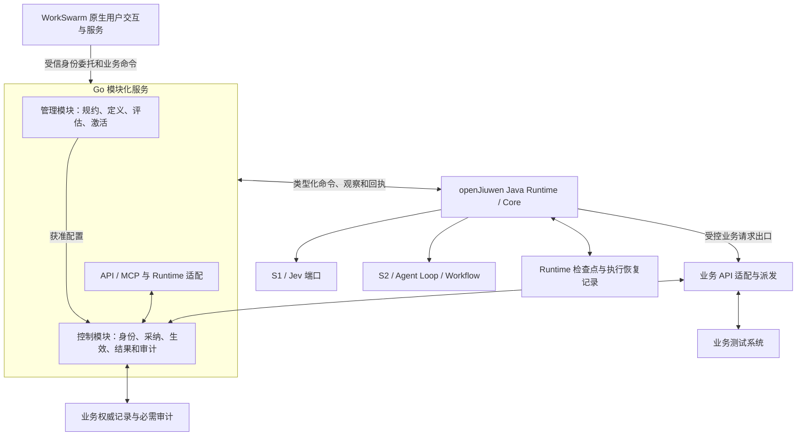

# agent hub alpha：总体架构与单流程受控试用提案

更新：2026-11-09。本文是当前主 proposal，持续原位维护；文件名保留用于兼容引用。专家 V0 的 [架构说明](05-architecture-brief-and-decisions.md) 与 [架构图](06-architecture-diagrams-md.md) 是演进输入；[研究背景](../design/nga-overall-design.md)说明与 NGA 模型研究的关系。

**状态：既定原则 + 待协商的集成契约，不是实现完成声明。** 本轮把 WorkSwarm、Go 服务和 openJiuwen Java Runtime 的集成方向具体化。三份契约分别定义对象归属、跨组件协议、派发与恢复；实际接收范围以 [08 验收状态](08-r1-r6-acceptance-and-open-items.md)为准。文中的接口名、状态名和 JSON 是候选契约，不声称上游已经提供这些业务接口。

## 1. 目标、既定原则与最小交付范围

第一交付目标是：**一个真实业务流程在业务测试环境中受控试用**。它应能从用户提交一直走到有依据的结果、等待、故障恢复和审计；不以完整企业工作台或模型训练平台为前置条件。

已确定的原则：

- 复用专家 V0 和 openJiuwen 基座，优先复用、配置、适配、使用公开扩展点；确有缺口再开发独立可替换组件。不能重复建设通用图执行器、Agent Loop 或部署管理平台。
- 企业业务图经过配置、验证、授权发布后固定版本。S2 辅助开发规划，运行时在节点契约内工作；S1/Jev 对限定问题作判断；框架负责检查、采纳、生效和恢复。
- 决策一致不代表正确。语义规约、证据、适用检查和业务 API 各自承担限定范围内的责任，不宣称框架能保证任意业务判断百分之百正确。
- 同一节点结果持久复用 R 与新任务知识消费 K 分开实现、共用受控入口。两者都不能绕过当前权限和业务请求生效条件。
- 业务系统通过 API 提供能力，维护其内部规则与数据；本项目不绕过银行接口直接修改内部字段。
- 一体三态四面是交叉的职责结构，不等于十二个服务。客户可以配置、导入、组合和扩展原语，接入者共同遵守控制与审计契约。

本轮提出的最小工程形态：

| 交付物 | 首版范围 | 不把什么当作已完成 |
| --- | --- | --- |
| WorkSwarm 用户面接入 | 复用原生交互，通过一个合格的 MCP/MCP Apps 接入路径提交、查询和干预试用流程 | 完整用户面重写、替换其全部原生后端 |
| Go 模块化服务 | 管理、控制、业务 API/MCP 适配及 Runtime 连接；一个服务内分模块 | 新建 Go 通用调度器或 Kubernetes 管理平台 |
| Java Runtime 适配组件 | 在现有 AgentServer/AgentHandler、Core Graph/Workflow/Agent Loop 上接入业务契约及受控工具出口 | 第二套 Runner、第二份业务权威账本 |
| 单流程参考应用与验收集 | 授信示例、一个持久后端、一组已声明能力的测试 API、恢复与隔离回放 | 真实模型能力、真实银行生产资格或多地域高可用 |

原提案的可嵌入 Java SDK/Starter 思路收敛为 **Runtime 的适配、装配与控制客户端组件**。可以提供 Spring Boot 自动装配，但不能因此让 Java 宿主与 Go 控制面同时拥有业务状态写入裁决权。独立嵌入部署若未来需要，必须作为另一种经过验收的部署剖面，不能在首版运行中隐式切换权威归属。

## 2. 复用边界与部署结构



图中 E、D、K 是责任与资源，不要求各自新建服务。派发适配可与现有 Runtime 工具出口集成；Go 决定是否允许派发，实际出口必须验证并执行对应约束。只有文档约束、实际工具仍可任意联网，不能算边界已落实。

### 2.1 上游能力与适配缺口

| 组件与源码依据 | 可复用的能力 | 仍须本项目验证的连接 |
| --- | --- | --- |
| [WorkSwarm README][swarm-readme]、[MCP 配置][swarm-mcp] | 原生交互、Agent 服务、MCP 与 MCP Apps 展示 | 它不是纯静态前端；须保留并部署其必要原生服务。MCP 连接可行不等于业务身份与审批授权已贯通 |
| [WorkSwarm MCP Apps 宿主][swarm-app] | 工具调用确认、交互展示 | 应用上下文、工具可见性和“始终允许”不能代替企业授权或对具体业务版本的批准 |
| [Java Runtime README][runtime-readme]、[AgentHandler][handler] | 现有服务生命周期、HTTP/A2A/SSE、Core 执行接入 | 技术 task、回调完成和会话结束不能直接映射成业务批准；prepare/query/complete 生命周期必须与重试和恢复契约对齐 |
| [Java Runtime A2A 适配][a2a-adapter] | DataPart/metadata 等结构化传递机制 | 协议字段存在不证明身份可信；不得假设任意 HTTP 字段自动透传。须实际验证绑定、认证、幂等和恢复 |
| [Java Core Workflow][workflow]、[ReAct][react]、[检查点恢复][step-recovery] | 图与工作流调度、Agent Loop、技术恢复 | 接入正式结果复用、受控分支及全部业务工具出口；检查点不是业务账本的替代品 |

源码检查只支持上述能力与限制，**不代表这些不同快照可以直接组合运行**。固定版本及依赖矩阵是 P01 验收内容。Core 引用为既有研究快照，Runtime/WorkSwarm 为本轮检查快照；不能用“都采用最新版”代替兼容性验证。

首版优先路径是：**WorkSwarm 原生交互 → MCP/MCP Apps → Go 业务接口 → 经验证的 A2A 或 HTTP 适配 → Java AgentHandler/Core**。MCP 只包装同一份业务服务契约，不另写业务规则。WorkSwarm 的 E2A/原生路由与 Java Runtime 的接口不是已证实可互换的协议；直接替换整个后端暂不作为首版承诺。

### 2.2 部署与唯一责任

- 第一部署剖面采用一个 Go 服务实例、一个合格 Runtime 执行所有者及已有持久存储，WorkSwarm 按其自身必要组件部署；不是承诺整个产品只需三个容器。
- 使用现有基础设施或已有部署管理能力提供部署、注册、健康与进程生命周期。Go 的企业管理面负责业务定义和治理，不接管所有基础设施管理职责。
- Runtime 是图的执行调度所有者；Go 对受保护边界检查和裁决，不能另运行一份竞争的图调度器。定时器可以由已有设施触发，Go 持久化业务期限和接受事件后的裁决。
- 业务写入只能通过控制模块的权威协议；管理模块通过授权激活/停用命令改变治理状态，不直接改任务结果。存储可共用技术产品，写入职责必须隔离。
- 不假设 SDK 能约束持有任意网络和业务凭据的恶意宿主。第一剖面须明确可信宿主、凭据归属和资源侧限制，验证直接工具、子工作流、重试与远程路径均不能绕过业务出口。

## 3. 一体三态四面与控制权

| 面 | 开发态 | 运行态 | 运营态 |
| --- | --- | --- | --- |
| 用户面 | 表达目标、试用与反馈 | 提交意图、补证、查询、提出干预 | 查看获准案例、反馈业务结果 |
| 管理面 | 治理语义规约、定义、权限与能力契约；评估后激活 | 管理适用范围、保鲜、停用及变更 | 归因、改进候选、评估和授权发布 |
| 运行面 | 集成组件、执行验证 | 运行固定图及节点方法、调用模型、等待与恢复 | 提供事实、诊断、执行隔离回放 |
| 控制面 | 检查发布与接入前提 | 实施身份、当前有效性、检查、权限、预算和生效约束 | 执行获准的恢复、纠错和迁移 |

**一体：案例 → 改进候选 → 评估 → 授权激活。** 可以复用上游知识、Skill、记忆与进化设施，但自动产生的 Skill 或 S2 反思只能成为候选，不能自行修改正式业务图、授权规则或已采纳结果。

管理面决定企业允许什么，控制面依据当前权威状态实施它，运行面执行获准动作。管理员也不能通过直接改库把失败改成成功；紧急操作必须有权限、对象、理由和记录。

| 能力 | 可以改变什么 | 必须重新采纳/批准的边界 |
| --- | --- | --- |
| S1/Jev | 针对限定问题产生类型化候选判断、依据与无法判断状态 | 候选本身没有发布、授权、执行或改历史的权力 |
| S2 | 开发态规划；节点内调查、补证、方法调整与评价 | 改变问题、依据、业务载荷或受治理方法，须按影响形成修订；改变正式业务图需新发布版本 |
| Runtime | 在已发布图内调度获准的节点与分支、恢复技术执行 | 不能以本地完成/检查点覆盖 Go 的正式结果，也不能自行增加预算与权限 |
| 控制模块 | 采纳候选、绑定请求、接受状态变化并形成回执 | 必须满足发布契约和当前有效条件；不替代银行内部事务，也不从模型信心推断外部成功 |

Jev 的输入是规约化的必要事实、来源、时间、冲突信息和版本，不是整份 S2 对话。信息压缩不能丢弃改变决策的证据；模型容量与判断质量单独实验。确定性分支可以复用获准规则组件，不强制每条边调用 Jev。

生产图固定，任务轨迹时序展开。Workflow 可以组成业务步骤或节点方法；Agent Loop 是节点的一种执行方式，节点也可直接调用工具、Workflow 或知识快路径。S2 的局部重规划不能偷偷改写外部业务义务。

## 4. 契约一：核心对象、状态归属与身份

以下“权威写入”指决定业务事实如何生效的唯一协议入口，不要求所有原始材料存入同一数据库。业务系统仍是实际业务结果的事实来源；Go 保存验证后的观察及其来源。

| 对象 | 权威写入与责任 | 绑定与变更规则 |
| --- | --- | --- |
| 定义 AD、语义规约 SP、能力/原语描述 | 管理模块的版本化治理流程 | 草稿可编辑；被发布引用的内容不可原位改写 |
| 发布 L、评估 EV、激活 ACT | 管理提出，控制模块验证授权并提交激活 | L 绑定内容摘要、兼容依赖、评估对象；ACT 绑定作用域和代次，发布不等于已获准运行 |
| 任务 T | 控制模块接受一次明确意图 | 绑定作用域、意图、L/ACT、参考时间与预算；会话号、相同客户或相同文字都不自动等于同一任务 |
| 节点执行实例 o | 控制协议登记，Runtime 获得执行所有权 | 重试、恢复保留 o；已发布图内合法新迭代使用新实例，保留父子关系和迭代依据 |
| 问题 J、候选与决策修订 D | S1/S2 提交候选，控制模块决定采纳与有效修订 | 绑定事实、规约、问题、时间、模型/readout 等依据；新实质依据创建关联修订，不覆盖历史 |
| 检查 C、业务批准 A | 合格检查者/审批主体产生，控制模块验证来源和适用性 | 绑定被检查对象、动作、摘要、时间与版本；调用者自报 checked=true 不成立 |
| 业务请求 B、派发尝试 a | 控制模块固定请求并授权尝试；出口执行，提供方回执确认结果 | B 固定目标、载荷、决策和授权作用域；重试沿用 B，新尝试有新 a；新 D 不自动生成新 B |
| 正式节点结果 R(o) | 控制模块条件提交 | 同一 o 只有一个正式提交；纠错以关联记录表达，不能覆盖原值；失败/未完成不能伪装成可复用成功 |
| 知识/方法制品 K | 管理治理版本及适用性，运行消费，控制验证准入 | 新任务使用 K 仍提交自己的 R(o)；失效禁止后续消费，不改写已发生事实 |
| 运营案例 CASE | 授权运营流程，关联正式记录 | 症状、归因和修复分开；案例或投诉不自动成为训练真值 |
| WorkSwarm 会话、消息与交互状态 | WorkSwarm | 引用 T 及回执；界面缓存不是正式状态 |
| Runtime 技术 task、检查点、执行日志 | Runtime | 映射 T/o/尝试；只描述技术执行，不单独认定业务成功 |

### 4.1 身份与不变量

令作用域 s 包含租户/业务域及合同要求的隔离维度。命令身份由受信入口分配并持久保存：

```text
k = (s, issuer, command_id)
h = H(Canonical(material_command))
同 k、同 h -> 同一原始命令回执
同 k、不同 h -> Conflict；无新业务效果
同客户、不同已接受意图 -> 可以是不同 T
同 o 的合法重试 -> 同一 R(o) 或原执行的等待/恢复
同 B 的重试 -> 同一目标和载荷，增加尝试记录而非重建业务意图
```

Canonical 的字段、编码、金额/单位和摘要算法属于版本化协议。哈希不能代替内容校验，调用者提供的摘要不能直接当真。跨语言 ID 使用不损失精度的表示；金额须声明币种和精确编码，不能依赖浮点数偶然相等。

正式结果不变量：`CommittedResults(o) ≤ 1`。它不要求崩溃前未提交的模型计算物理上只运行一次。Agent Loop 的外部副作用必须拆成受控子操作，各自绑定 B；不能把“最后输出被缓存”当作整个 Loop 的效果幂等。

失败的技术尝试可以尚未形成正式结果；已正式提交的业务拒绝或终态失败则同样原样复用，不能为了“重试成功”覆盖它。需要重新处理业务意图时，按明确权限创建关联的新实例/任务，保留原结果和理由。

当前有效修订由显式采纳/替代关系决定，不取“存储中最大修订号”。旧记录可在权限允许时读取供审计，但读取历史结果不赋予当前派发权。相同任务有新证据时，先登记依据变化与影响范围，再形成修订或补证等待；重新调用模型不能直接生效。

### 4.2 两条快路径必须汇合

```text
受信入口 -> 校验身份和命令材料
          -> R：原 o 已有正式结果？返回原回执/结果
          -> 原 o 进行中？加入原执行或受控恢复
          -> K：新 o 匹配获准知识/方法？检查保鲜、适用性、权限后执行
          -> 否则运行获准 Workflow / Agent Loop
          -> 同一套检查、正式结果提交、业务请求生效与审计协议
```

K 匹配成功不能直接返回他人的业务结果。即便未调用模型，新 o 仍须形成正式结果；后续重试可走 R。相似度只提供检索候选，不能定义业务等价。知识快路径可能免模型，但不必免本次业务 API。

## 5. 契约二：命令、观察、回执与投影

### 5.1 最小消息约定

一个候选命令信封如下；可复用 MCP/A2A/HTTP 传输，不要求新造协议栈：

```json
{
  "contract_version": "alpha-1",
  "kind": "command",
  "command_id": "cmd-104",
  "scope_id": "credit-pilot",
  "task_id": "T1",
  "operation_id": "o-submit-1",
  "release_id": "L1",
  "expected_generation": 7,
  "action": "BindBusinessRequest",
  "payload": {
    "decision_id": "D1",
    "business_request_id": "B1",
    "target_contract": "credit-api-test-v1",
    "amount_minor": "5000000",
    "currency": "USD"
  }
}
```

认证和委托从受信连接/凭据获得，不信任消息自报 actor。信封中的 T、o、D、L、作用域必须彼此匹配并与服务端记录核对。外层 o 与内部请求 o 不一致时拒绝，不能一边检查外层、一边执行内层。

MCP 共享服务凭据只能证明调用服务，不能自动证明最终用户批准了这次授信。需要明确用户身份委托、权限、批准对象和摘要。WorkSwarm 的“允许工具调用”也不等于业务审批；必要审批必须绑定具体目标、版本、金额/内容与期限，Go 校验其当前有效性。

### 5.2 四种不同的事实

| 类型 | 意义 | 禁止混用 |
| --- | --- | --- |
| 命令 | 请求执行有权限和前置条件的变化 | 命令送达不等于已接受或业务成功 |
| 观察 | 合格生产者报告证据、技术事件或 API 回执 | Runtime 不得用任意状态字符串直接把业务改成批准 |
| 回执 | 控制面已经接受/拒绝的这一次命令及其效果范围 | 重试返回原回执，不让旧回执成为新的派发许可 |
| 状态投影 | 从权威记录得到的当前查询视图 | UI/缓存/技术任务状态不覆盖权威事实 |

至少区分：命令接受、任务运行、决策采纳、业务 API 受理、业务 API 终态、恢复状态。API accepted 不等于 credit approved；技术调用完成也不等于以上任一业务终态。查询原命令回执和查询当前任务状态是两个操作。

命令类别包括发布/激活、启动/补证/干预、取得节点执行权、提交候选/采纳、绑定业务请求、提交派发/重试、提交正式结果。具体接口可合并，逻辑义务不能消失。

### 5.3 接收顺序、冲突与重复

1. 验证身份、作用域及读取该回执的当前权限；解析版本，拒绝无法安全解释的字段组合。
2. 查命令去重记录。同 k 不同 h 拒绝；同 k 同 h 返回原回执或原进行中操作，不重做业务逻辑。
3. 只有新命令才以 expected_generation 和当前权威状态检查前置条件；在同一权威顺序内提交状态变化、去重回执和必需审计。
4. 原命令重试时即使代次已推进，也不能先以旧 expected_generation 拒绝，再迫使调用方新建命令。权限撤销后也不能为了去重泄露原私人结果。

观察按 `(producer_id, event_id)` 去重，并校验载荷、来源及因果绑定。重复 ID 改载荷是冲突；晚到事件保留证据，但不能把已确认终态倒退成 pending。冲突终态进入核验，不以最后到达者覆盖。事件时间不作为唯一排序依据，权威提交顺序和提供方的合格版本/状态契约决定如何采纳。

持久 outbox/inbox 可以复用现有设施，实现可重送与可去重；保证的是限定条件下的一次接受和状态变化，不是网络只发送一次。协议版本不兼容、精度丢失或关键字段缺失必须可观察，不允许静默降级为默认通过。

## 6. 契约三：生效、派发与恢复

### 6.1 检查与生效必须绑定同一对象

令 σ 为权威状态，o 为受保护操作，β 为绑定的业务材料（包括决策、请求、载荷及相关依据）。在提交边界验证：

```text
Eligible(o, σ) = Ready(o, σ)
              ∧ AuthorizedNow(o, σ)
              ∧ Current(o.bound_revision, scope(o), σ)
              ∧ ApplicableChecks(β, σ)
              ∧ FinalPayloadMatches(β)
              ∧ OwnerAndBudgetValid(o, σ)

CommitDispatch(o, expected_generation)
    仅当 Eligible(o, σ) 且 expected_generation = generation(scope(o), σ)
    原子提交：尝试/派发意图 + 状态推进 + 必需审计 + 对应命令回执
```

ApplicableChecks 必须覆盖要求的检查项、真实对象、动作、参考时间、检查者/规约版本、有效期限及结果。检查通过只证明该检查器声明的属性；不能由一张形式合格的检查记录推导整个业务判断正确。检查失败/无法判断按发布规约处理，S2 不得自由生成“例外批准”。

Ready 还须验证 Runtime 实际加载的图、规约和能力版本与 L 的内容绑定一致，必需配置与提供方可用；不能只接受调用方自报 release_id。适配器必须能提供并核对这一映射，否则冻结发布图只是文档约定。

权限、修订与本地生效意图必须在同一权威顺序下裁决。外部 IAM 的撤销如果不能参与这一顺序，必须声明授权凭据有效期、刷新/撤销传播界限；不能宣称与外部系统即时全局原子。

### 6.2 请求状态与尝试状态分开

B 绑定后其业务载荷固定。以下是业务观察与控制状态；并不要求使用这些英文枚举：

```text
BOUND --CommitDispatch--> DISPATCH_COMMITTED
DISPATCH_COMMITTED --提供方受理--> PENDING
DISPATCH_COMMITTED / PENDING --合格终态证据--> SUCCEEDED / DECLINED / FAILED_CONFIRMED
BOUND --确认尚未提交派发并撤回--> WITHDRAWN_BEFORE_COMMIT
DISPATCH_COMMITTED / PENDING --超时、断线或回执丢失--> UNRESOLVED
UNRESOLVED --查询、晚到回执或受控重试--> PENDING / 合格终态
```

UNRESOLVED 表示结果未知，可以实现为独立状态维度；绝不能默认为失败。每个尝试 a 另记发送、网络失败、响应及时间，某次尝试失败不自动使 B 失败。取消是独立请求及其确认；只有提供方确认取消才可投影 CANCELLED_CONFIRMED，取消失败不覆盖原操作。

**逻辑派发提交是本地控制边界，不是业务系统的事务提交。** 在此之前权限撤销、有效修订变化可以阻止派发；在此之后即使尚未观察到发送，恢复时也可能无法证明请求未离开系统。撤销与新证据必须进入查询、等待或受支持取消流程，不能承诺“撤销之后绝不发生外部效果”。

派发凭证如被使用，必须绑定 B、载荷摘要、尝试、执行所有者代次与相关策略，不是可转移的 approved 布尔值。重复获得派发回执不等于获准再次物理发送；恢复必须先依据尝试记录和 API 能力裁决。

### 6.3 API 能力契约及故障处理

每个业务 API 至少声明：操作语义/副作用、认证作用域、幂等键与有效期、查询方式、受理/终态映射、超时含义、可否取消、可否补偿、错误分类和审计凭据。查询可能有延迟，“暂未查到”不当然证明未受理。

| 故障或变化 | 框架直接处理 | 需要 S1/S2 或业务参与的部分 |
| --- | --- | --- |
| 等待、超时、重复/晚到回执 | 持久 Await、关联键、截止时间、受控单次继续；未知状态与预算 | 规约允许时补证、解释或提出处置；不能将超时判断成业务失败 |
| 派发前崩溃 | 从意图/尝试及权威记录恢复，检查是否已有提交 | 不重新规划新业务意图来绕开原记录 |
| 业务已受理、本地未记回执 | 查询或等待；只有契约支持时同 B 同载荷重试 | API 不可查且无幂等承诺时保留未知，转有权限的人工核验；不盲目重发 |
| 本地取消或用户关页 | 停止本地计算与业务取消分开 | 用户可申请取消；支持与否及效果取决于 API |
| 补偿 | 独立操作、授权、记录部分完成和恢复关系 | 选择可用业务补偿方式；没有能力就明确不支持，不伪装成数据库回滚 |
| 新证据、规则变更 | 记录影响、建立修订；必要时阻断尚未提交的效果 | S2 可补证，S1 重新判断；改变图需新发布，不静默迁移旧任务 |
| 控制服务/存储不可用 | 不批准新的受保护效果；恢复后核对正式记录 | 已在途回执通过合格持久缓冲或提供方查询恢复；无此能力则不通过恢复验收 |

失败重试仍需预算、权限和依据有效性检查，不能无限使用旧许可；为同一 B 创建新尝试而不是绕过限制创建新 B。API 幂等键过期后禁止把历史同键重送当作当然安全。

`ActiveOwners(o) ≤ 1` 是逻辑执行权要求。旧 worker 可能仍存活，只有数据库租约不能阻止其外部效果：须在受控出口拒绝旧代次，且通过提供方幂等/可验证停止等条件约束已在途请求。首版不承诺任意多实例自动接管；不具备这些条件时停止派发、等待核验。

### 6.4 结果、检查点、审计与回放

- Go 已提交正式结果、Runtime 检查点落后：读取正式结果并恢复推进，不再启动同一节点的 Agent Loop。
- Runtime 检查点领先、Go 无正式结果：不得将技术完成直接补成业务成功；按命令回执、意图和提供方结果核对。尚未提交的纯计算允许重算，已发生效果不能靠重算掩盖。
- 正式结果及关键意图与必需审计在声明的原子单元中持久化；遥测丢失不能丢失这些事实。正常拒绝也保留原因及绑定对象。若必需存储本身不可用，返回不可用且不产生新效果，不能承诺此时每条拒绝都已持久化；独立告警属于另行验证的运行能力。
- 回放消费冻结版本与记录的非确定输入，禁止真实模型/业务/发布副作用，验证状态转移、采纳与意图。缺证据明确失败；重新评估另建身份。回放一致证明过程可重现，不证明原业务判断正确。

## 7. 语义规约、扩展与可用性

必须区别：未配置、明确配置为空、规则未覆盖、证据不足/冲突、能力执行失败、结果未知。发布前拒绝缺失必需规约；运行时遇到未覆盖场景，按已发布的补证、等待、复核或明确未决路线处理。没有获准降级规则时不能由模型补成许可，也不应默认解释为业务拒绝。

客户扩展原语须声明输入输出、状态机、权限、副作用、预算、等待/恢复、版本与审计。首版验证一种配置/导入形式和一个自定义处理器即可；不要求先开发市场和通用插件平台。实现上优先复用 openJiuwen 的工具、Workflow、检查点和扩展钩子，新增部分为契约接线与缺失机制。

历史语义规约不可原位改变；保鲜通过适用范围、有效期、依赖变化、评估和受控停用表达。首版可以固定版本加保守重验，不依赖通用依赖图已经存在。当前撤销仍可阻止旧版本任务的新效果；长期任务保留版本资源，或经显式迁移处理。

可用性验收除了拒绝不安全动作，还要证明有效流程有用：正常授信/拒绝、补证后继续、故障后恢复与获准知识快路径均可完成。总是拒绝不是系统目标。响应/恢复时间、保留期及容量由试用约束确定并测量，不能由架构图直接承诺 SLA。

## 8. 授信流程贯穿三份契约

原规则完整保留：资产大于 3000 万且过去 6 个月无逾期，授予 5 万美元；资产小于 100 万，授予 1 万美元；历史有持续超过 3 个月的逾期则否决。单位、精确阈值、日历边界、有效数据和未覆盖去向须在发布规约中明确；本提案不替银行定义内部总额度逻辑。

1. **开发与发布。** 管理面形成 SP1、固定图 AD1、工具/模型/原语依赖，封存 L1 后评估 EV1。控制面验证后激活 ACT1。S2 可以辅助写图，不自行发布。
2. **用户提交。** WorkSwarm 提交命令 cmd-1，可信接口绑定用户意图，Go 接受 T1/L1。网络重试仍用 cmd-1；对话下一条消息不能自动当新申请。
3. **收集与快路径。** Runtime 获得节点 o1；S2 通过获准接口补证。若治理后的方法 K1 适用，可以不调用模型，但仍生成本次 o1 的正式结果。后续 o1 重试直接读取它。
4. **决策。** S1 对 J1 的规约化事实 E1 输出 D1 候选。近期短期逾期可能使上带条件不成立，但不触发历史长期否决；不得擅自补成授信或拒绝。检查 C1 核对对象、动作、时间与版本；必要人工批准 A1 绑定确切内容。Go 采纳，业务系统尚未批准。
5. **绑定和派发。** 对符合上带的已验收夹具，固定 B1=申请 USD 50,000 及测试 API。提交边界再次核对当前有效修订、权限、检查和最终载荷；持久意图后调用。若工具改成 USD 60,000，原检查不适用，派发必须被阻止。
6. **等待与恢复。** API 受理返回 pending，WorkSwarm 展示等待。进程重启不新建申请；恢复查询 B1。API 确认后形成正式业务结果和节点结果，重试读取原记录。
7. **处理变化。** 新证据 E2 产生关联修订 D2。派发提交前，当前依据变化阻止旧 D1；提交后，不能用 D2 覆盖在途 B1，按 API 查询/取消/后续操作处理。发布 L2 影响新任务，T1 不静默换图。
8. **运营与进化。** CASE1 记录“受理被显示为已批准”的症状，核对原回执与 UI 投影。修复候选经过评估、授权激活；不把此界面错误归咎于 Jev，不重发 B1。旧事实和回放继续可用。

## 9. 多轮对抗检查：反例与收紧后的边界

以下是对提案的逻辑攻击与设计回应，不等于所有工程反例已通过：

| 轮次 | 独立攻击 | 必须维持的约束及工程验收 |
| --- | --- | --- |
| 责任轮 | WorkSwarm Leader 与 Runtime 都重新规划业务，Go 又有自己的调度 | 正式图固定，Runtime 唯一调度所有者，WorkSwarm 仅提意图，Go 只在受保护边界裁决；检查所有入口 |
| 身份轮 | 模型每次重试生成新 UUID；同客户一律去重；外层 o 与内部 o 不同 | 可信入口保存命令身份；独立意图与重试区分；所有绑定对照权威记录 |
| 幂等轮 | 完成后改输入仍返回旧结果；K 成功未落正式结果，失效后又启动模型 | 同键改材料冲突；R/K 共用正式提交；同一 o 完成后不重跑；失效只改变后续适用性 |
| 授权轮 | MCP readOnly/always-allow 当批准；先检查后改金额；旧修订派发 | 确切对象与批准绑定、最终载荷校验、当前修订保护；直接工具及远程入口同样受控 |
| 崩溃轮 | API 已受理后进程崩溃；旧 worker 复活；取消与回执竞态 | 未知结果不盲重发；提供方能力、出口代次控制和恢复实测；本地撤销不冒充外部回滚 |
| 可用性轮 | 必需规约缺失仍默认通过；依赖中断就改成拒贷；一律拒绝维持安全 | 无效发布拒绝、未覆盖/未知显式处理，正常有用流程和恢复均须通过 |
| 证据轮 | 参考组件测试全绿就称集成完成；用回放一致证明模型正确 | 组件/组合/真模型资格分别报告；反例和变异检验真实入口；核对必需审计来源 |

设计只能在声明假设下收紧风险，不能证明没有任何逻辑漏洞。尤其用户身份委托、最终效果出口覆盖、真实恢复能力仍须工程证据。

## 10. 最小验收门槛与旧验收 ID 延续

保留 M01—M15，便于追踪原提案承诺；载体从独立 Java SDK 调整为上述组合。所有条目均为要求，不能据本次文档更新标记通过。

| ID | 需要证明的行为 |
| --- | --- |
| M01 | WorkSwarm、Go、Runtime 的固定依赖和部署可以启动；配置/提供方可替换；只有一个合格 Runner 生命周期和业务权威协议，错误效果配置不能运行 |
| M02 | 有用授信、拒绝及未决路径；等价一致和实质差异区分；真模型与替身结果分报 |
| M03 | 重复/并发命令同回执、同键改材料冲突、独立合法意图可创建任务 |
| M04 | 重规划、重试、子工作流恢复维持必要 T/J/D/B 关系；依据变化产生关联修订 |
| M05 | 发布/激活竞争不静默迁移任务；当前撤销阻止尚未提交的新效果 |
| M06 | 检查后载荷变化被阻止；工作流、直接工具、重试和远程路径不可绕过效果边界 |
| M07 | 派发前及 API 受理后、本地记录前崩溃；按提供方契约恢复并控制重复效果，缺能力明确报告 |
| M08 | 持久 Await 跨重启，重复/晚到/期限竞态只有受控继续，外部状态真实 |
| M09 | 超时、断线、本地取消不冒充业务失败；取消请求及确认分开 |
| M10 | 合格补偿夹具保留已完成步骤和部分恢复；无回退 API 的场景不接受必须回退的承诺 |
| M11 | 嵌套 Loop、工具、外发重试共用预算及请求身份；子权限/预算不膨胀 |
| M12 | 必需意图/证据持久化、遥测丢失不影响；记录失败不批准新效果；检查点差异可核对恢复 |
| M13 | 隔离回放复现控制过程，检测改金额/分支/版本和缺证据；不产生真实效果 |
| M14 | 一种配置/导入原语及一个自定义处理器走同一契约；不兼容版本/检查点替换被拒绝或显式迁移 |
| M15 | CASE → 候选 → 评估 → 激活完整路径，修复状态映射而保留旧 D/B/回放；候选不能批准自身 |

首个单流程试用优先补齐以下组合证据。每项报告源码版本、环境、假设、正常样例、反例与预期结果；“已有接口”不足以关闭：

| 试用门槛 | 验收对象与责任 | 对应旧 ID |
| --- | --- | --- |
| P01 | 集成负责人：固定兼容矩阵和可启动部署；WorkSwarm 用户身份到 Go、结构化命令到 Runtime 的实测 | M01 |
| P02 | 控制 + 用户面：相同命令重试、改载荷冲突、独立意图、撤销后的查询权限 | M03、M05 |
| P03 | Runtime + 控制：R/K 共入口，K 产生新正式结果，重试不再调用模型；并发只有一次正式提交 | M03、M04 |
| P04 | 模型/规约 + 控制：真实采纳路径中的检查，外内对象一致，旧修订和载荷变化被阻止 | M02、M05、M06 |
| P05 | API/Runtime + 控制：受理后崩溃、未知结果恢复、同 B 重试、幂等窗口过期、旧 worker | M07、M11、M12 |
| P06 | Runtime + 用户面：等待重启、迟到/重复回执、超时/取消的真实状态显示 | M08、M09 |
| P07 | 控制 + 运营：正式结果与必需审计连接、拒绝路径、存储故障无新效果、隔离回放 | M12、M13 |
| P08 | 管理 + 运营：最小案例改进闭环及一种客户扩展，版本保鲜与旧任务兼容 | M14、M15 |

若试用明确不要求业务回退，可把通用补偿留为后续增量，但须显式显示不支持，不能把 M10 标记通过。实际需要取消/补偿的流程必须补对应能力测试。高可用多实例、完整工作台、跨引擎迁移和多地域不作为首版完成条件。

## 11. 工程顺序与待讨论事项

1. **先定边界和证据提供方。** 将 §4—6 对应到现有组件，冻结首个协议与依赖矩阵；列清身份、存储、出口、检查器和 API 提供方。
2. **跑通一条垂直链路。** 原生 WorkSwarm 入口 → Go → Java Runtime → 测试业务 API → 结果展示；接通正式 R/K 与持久记录，不扩大 UI 范围。
3. **注入失败再谈验收。** 先改材料/越权/修订竞争，再测受理后崩溃、断线、晚到事件、存储故障和恢复；不能只跑正常成功路径。
4. **补齐运营与扩展闭环。** 最小案例、评估、授权激活、规约保鲜及客户原语样例；达到试用门槛后再扩展部署与生态能力。

需要与工程团队共同确认的内容：

| 待讨论问题 | 已锁定的边界 | 可以选择的部分 |
| --- | --- | --- |
| WorkSwarm 如何承载身份与批准 | 工具调用确认不能替代企业审批 | 现有身份系统、委托方式及最小交互 |
| Go 到 Java 的调用协议 | 类型化身份与材料不得丢失，技术任务不冒充业务任务 | 合格 A2A 或 HTTP、同步回执与事件传送方式 |
| 持久与权威顺序 | 状态/回执/必需审计的原子性与单一裁决责任 | 现有数据库、事务/outbox、计时设施与保留期 |
| 业务效果出口 | 所有实际效果可被同一契约约束；明确可信宿主和提供方假设 | Runtime 工具适配、资源侧网关或现有企业能力 |
| 规则未覆盖与降级 | 未知不是业务拒绝，模型不能自行补规则 | 每个业务域获准的等待、复核、补证及时间预算 |
| 试用指标和可选能力 | 有用性与安全/恢复同时验收，不夸大保证 | 延迟、成本、保留期、补偿范围与后续高可用目标 |

本轮不新增并列 proposal，不把历史进度写成当前能力。新证据进入 08 或代码旁的验收材料；当前方案持续维护本文。

<!-- 源码快照仅支撑相应能力观察，不代表组合集成已通过。 -->
[swarm-readme]: https://github.com/openJiuwen-ai/jiuwenswarm/blob/57546af0128573fa008e3fb1794eb9538bbcc280/README.md
[swarm-mcp]: https://github.com/openJiuwen-ai/jiuwenswarm/blob/57546af0128573fa008e3fb1794eb9538bbcc280/docs/en/MCPConfiguration.md
[swarm-app]: https://github.com/openJiuwen-ai/jiuwenswarm/blob/57546af0128573fa008e3fb1794eb9538bbcc280/jiuwenswarm/channels/web/frontend/src/components/ChatPanel/McpAppView.tsx
[runtime-readme]: https://github.com/openJiuwen-ai/agent-runtime-java/blob/2b29d534a0b872d840d21c13b94d3843995799b8/README.md
[handler]: https://github.com/openJiuwen-ai/agent-runtime-java/blob/2b29d534a0b872d840d21c13b94d3843995799b8/service/agent-service-spec/src/main/java/com/openjiuwen/service/spec/spi/AgentHandler.java
[a2a-adapter]: https://github.com/openJiuwen-ai/agent-runtime-java/blob/2b29d534a0b872d840d21c13b94d3843995799b8/service/agent-service-app/src/main/java/com/openjiuwen/service/app/controller/a2a/A2AProtocolAdapter.java
[workflow]: https://github.com/openJiuwen-ai/agent-core-java/blob/46673c69333a702d74923ca03caf7e0649132286/core/src/main/java/com/openjiuwen/core/workflow/Workflow.java
[react]: https://github.com/openJiuwen-ai/agent-core-java/blob/46673c69333a702d74923ca03caf7e0649132286/core/src/main/java/com/openjiuwen/core/singleagent/agents/ReActAgent.java
[step-recovery]: https://github.com/openJiuwen-ai/agent-core-java/blob/46673c69333a702d74923ca03caf7e0649132286/core/src/main/java/com/openjiuwen/core/session/checkpointer/step/StepCheckpointRecoveryService.java
